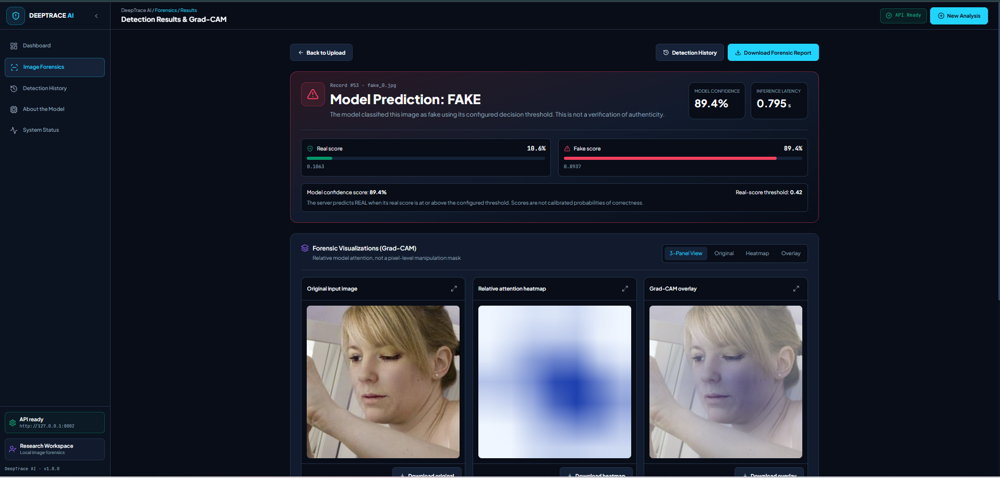
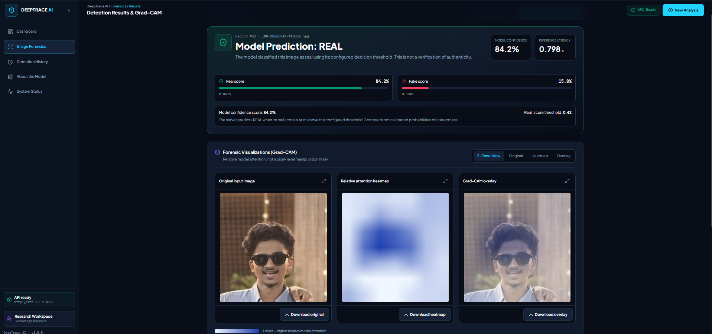

# 🔍 DeepTrace AI — Deepfake Image Detection & Forensics

<p align="center">
  
  
  
  
  
  
  
  
</p>

<p align="center">
  <strong>An AI-powered application for detecting potentially manipulated images using deep learning.</strong>
</p>

---

## 📌 Overview

**DeepTrace AI** is a deep learning-based deepfake image detection and forensic analysis system designed to classify uploaded images as **REAL** or **FAKE**.

The application combines a TensorFlow-based image classification model with a FastAPI backend and a React frontend to provide an interactive image analysis experience.

It also provides visual explanations through Grad-CAM, prediction scores, and detection history to help users understand the model's output.

## ✨ Key Features

- **Deepfake Image Detection:** Classifies uploaded images as REAL or FAKE.
- **Deep Learning Model:** Uses an EfficientNetB0-based image classification model.
- **Prediction Analysis:** Displays REAL and FAKE scores.
- **Grad-CAM Visualization:** Highlights image regions that influence the model's prediction.
- **Detection History:** Stores and displays previous prediction records.
- **Interactive Dashboard:** Provides an overview of detection activity.
- **Backend API:** Handles image uploads and prediction requests using FastAPI.
- **System Status:** Provides backend health and model availability information.

## 🖥️ Application Screenshots

### 1. Fake Image Detection

<p align="center">
  
</p>

<p align="center">
  <em>Example application output showing a FAKE prediction.</em>
</p>

### 2. Real Image Detection

<p align="center">
  
</p>

<p align="center">
  <em>Example application output showing a REAL prediction.</em>
</p>

## 🏗️ System Architecture

```text
                USER
                  |
                  v
          REACT FRONTEND
                  |
            Image Upload
                  |
                  v
           FASTAPI BACKEND
                  |
          Image Preprocessing
                  |
                  v
       EFFICIENTNETB0 MODEL
                  |
          Prediction Output
                  |
          +-------+-------+
          |               |
          v               v
      REAL / FAKE      GRAD-CAM
          |               |
          +-------+-------+
                  |
                  v
          RESULT DASHBOARD
                  |
                  v
          SQLITE DATABASE
```

## 🛠️ Technologies Used

| Category | Technologies |
|---|---|
| Programming Language | Python, TypeScript, JavaScript |
| Deep Learning | TensorFlow, Keras |
| Model Architecture | EfficientNetB0 |
| Backend | FastAPI, Uvicorn |
| Frontend | React.js, TypeScript, Vite |
| Image Processing | OpenCV, Pillow |
| Explainable AI | Grad-CAM |
| Database | SQLite |
| Styling | Tailwind CSS |
| Testing | Pytest, Playwright |
| Development Tools | VS Code, Git, GitHub |

## 📂 Project Structure

```text
Deepfake-Image-Detection/
│
├── assets/
│   └── screenshots/
│       ├── fake-detection.png
│       └── real-detection.png
│
├── backend/
│   ├── app/
│   │   ├── routes/
│   │   ├── services/
│   │   └── utils/
│   ├── model/
│   │   ├── deepfake_model.keras
│   │   └── threshold.json
│   ├── tests/
│   ├── tools/
│   ├── main.py
│   └── requirements.txt
│
├── completion-final/
│   └── project-report/
│
├── deeptrace-ai---deepfake-image-detection-&-forensics/
│   ├── src/
│   ├── tests/
│   ├── package.json
│   └── vite.config.ts
│
├── .gitignore
├── README.md
└── Start-DeepTrace.ps1
```

## ⚙️ Installation and Setup

### Prerequisites

- Python 3.10+
- Node.js and npm
- Git

### 1. Clone the repository

```bash
git clone https://github.com/Mohdafras/DeepTrace-AI.git
cd DeepTrace-AI
```

### 2. Set up the backend

```bash
cd backend
python -m venv venv
```

Activate the virtual environment:

**Windows PowerShell:**

```powershell
.\venv\Scripts\Activate.ps1
```

Install dependencies:

```bash
pip install -r requirements.txt
```

Configure your environment using the provided `.env.example` file and your backend configuration requirements.

Start the backend:

```bash
uvicorn main:app --reload --port 8002
```

Backend API:

```text
http://127.0.0.1:8002
```

API documentation:

```text
http://127.0.0.1:8002/docs
```

### 3. Set up the frontend

Open a new terminal from the project root:

```bash
cd "deeptrace-ai---deepfake-image-detection-&-forensics"
npm install
npm run dev
```

Frontend:

```text
http://127.0.0.1:5173
```

Configure the frontend API URL according to the provided `.env.example` and frontend configuration.

## 📊 Model Evaluation

The project includes model evaluation and training audit documentation.

The previously evaluated production model recorded the following frozen-test results:

| Metric | Result |
|---|---:|
| Accuracy | 69.89% |
| Balanced Accuracy | 69.78% |
| Fake Recall | 83.90% |
| Real Recall | 55.66% |
| ROC AUC | 0.8009 |

**Note:** These are historical evaluation results for the production model, not a claim of independently verified current performance. The frozen test set has already been used and should not be treated as an independent test for future experiments.

For further details, refer to:

- `completion-final/TRAINING_AUDIT.md`
- `completion-final/VALIDATION_REPORT.md`
- `completion-final/INDEPENDENT_EVALUATION_PLAN.md`

## 🔮 Future Enhancements

- Improve model generalization using more diverse datasets.
- Conduct independent evaluation on an untouched test dataset.
- Explore video-based deepfake detection.
- Improve prediction calibration and reliability.
- Extend forensic analysis and explainability features.
- Deploy the application for wider accessibility.

## 🎓 Academic Project

**Project Title:** Deepfake Image Detection Using Deep Learning  
**Subject:** Deep Learning & Reinforcement Learning  
**Department:** Artificial Intelligence & Machine Learning  
**Institution:** P.A. College of Engineering, Mangalore

## 👩‍💻 Author

**Mohammed Shazin Afras**

BE – Artificial Intelligence & Machine Learning

[GitHub Profile](https://github.com/Mohdafras)

---